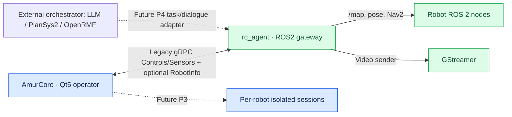

# Architecture

rc_agent is a ROS 2/C++17 gateway on the robot. It reports agent-configured capabilities and bridges existing ROS 2 topics/actions and gRPC connections. It does not implement inverse kinematics, gait, motor control, LLM execution or fleet allocation.

## Current P1 flow

Solid lines describe existing pathways at P1. Dashed lines show agreed **future** phases; these are **not** proof of completed runtime integration.

## Contract boundaries

- ROS2 topic/service/action and allowed local endpoint bindings belong in rc_agent configuration; arbitrary remote endpoints are forbidden.
- The robot advertises semantic capability IDs and axes, **not** concrete ROS topic names.
- Robot-side motor control, gait, IK, scheduling and LLM/PlanSys2/OpenRMF execution are external.
- Both repos must use byte-for-byte identical `network/protobuf/rc_api_v2.proto` and `robot.proto`.
- Legacy Control/Sensor field numbers must remain stable during migration.
- No multiple active robots may share the same global sensor/control session state.

The approved [cross-repository implementation plan](https://github.com/ARDev1161/AmurCore/blob/feat/rc-api-v2/PLAN.md) is authoritative if this overview is older than the code.
